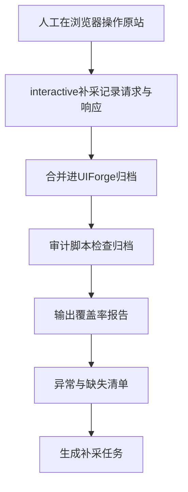

# API 采集补全与覆盖率审计（MVP）设计方案

日期：2026-11-28
状态：MVP 已评审通过，实施中
关联：`dev-docs/experience/uiforge-explore-misses-interaction-gated-views.md`（2026-11-28 实战案例）

## 一、背景

网站克隆时 API 漏采不是单一原因，而是三类问题叠加：

| 根因 | 表现 | 已有证据 |
|------|------|----------|
| 交互路径未触发 | 自动探索点不到多步中文导航，子视图 API 从未被录制 | 经验文档：向导视图需四步操作才出现 |
| 响应未保存 | 超大响应被静默丢弃、读取失败被吞掉 | 源码确认，无任何失败记录 |
| 回放匹配错误 | 同 URL 不同请求体互相覆盖，回放拿错数据 | 源码确认，key 只含 URL |

目标：先分清楚每次漏采属于哪一类，再决定要不要做完整 Replay Engine。

## 二、已核实的缺陷清单（对源码逐条验证）

| 编号 | 缺陷 | 位置 | 影响 |
|------|------|------|------|
| A | 归档 key 是 `method + 归一化URL`，请求体不参与；同 URL 不同 Body 后者覆盖前者 | `uiforge-archive.mjs:117`、`capture-steps.mjs:65` | 离线回放搜索 A 返回搜索 B 的数据 |
| B | 响应体读取失败或超 12MB 时直接 return，整个 handler 外层 `catch {}` | `uiforge-archive.mjs:118`、`capture-steps.mjs:62` | 报告的响应数不代表真实捕获率 |
| C | 采集端从不调用 `request.postData()`，请求体从未入库 | 两份采集脚本 | P0 级「URL + Body」匹配的数据源头不存在 |
| D | 回放未命中一律返回 204，无诊断信息 | 归档内生成的 `serve.mjs` | 缺 API 表现为静默空白（助手面板案例） |
| E | 录到的 5xx 回放时被改写为 200（`status < 500 ? status : 200`） | 同上 | 审计需对比录制态与回放态状态码 |

关键事实：**serve.mjs 是模板生成进归档的文件**（不是子模块的一部分），归档本就允许手工编辑。因此回放行为升级（D/E/匹配规则）走「workspace 级模板 + 生成后写入归档」路径，不需要 fork `thirdparties/UIForge`。

## 三、选型结论

| 工具 | 角色 | 结论 |
|------|------|------|
| UIForge 归档 | 主采集（页面 + 资源 + 初始 API） | 沿用，不改子模块 |
| Playwright（已在 workspace/common） | 交互补采 + HAR 标准交换格式 | MVP 采用 |
| Browser Bridge Watch Mode（thirdparties 已引入） | 人工操作因果时间线、防响应体驱逐、多 tab | Phase 2 接入 |
| mitmproxy + mitmproxy2swagger | 第三采集通道 + OpenAPI 生成 | **砍掉**。单站知识库不需要 OpenAPI，端点清单从 JSONL 可直接生成；双通道已够交叉验证 |

类比：UIForge 归档像一个按 URL 编号的储物柜，同一格永远只放最后放进去的东西。修复后的 key 相当于「URL + 请求体指纹」分格，同格不同请求体不再互相顶掉。

## 四、三期规划



### MVP（本次实施）：补采与完整性审计

1. 修复 `capture-steps.mjs` 三个缺陷：
   - key 追加请求体 sha256 前 12 位（`URL#hash`），变体不再互相覆盖
   - 丢弃/读取失败写入 `capture-failures.jsonl`（时间、方法、URL、原因、大小）
   - 记录 `request.postData()` 进归档条目（字段 `reqBody`）
   - 新增 `--interactive` 模式：有头浏览器人工操作，终端回车结束录制后合并
2. 新增 `api-coverage-audit.mjs`（skill scripts）：端点清点、异常状态扫描、变体冲突检测、丢弃统计、请求体缺失标记
3. 对 bishuxiezuo 现有归档产出首份基线报告

验收：报告能明确列出哪些 API 有异常、哪些存在变体冲突、哪些数据被丢弃；`--interactive` 全程人工操作可录全量 API 并安全合并。

### Phase 2：统一格式与回放升级

- 接入 Browser Bridge Watch Mode（因果时间线：哪个点击触发哪个 API）
- 统一 `api-catalog`（最小字段集：bodyHash + source，不做 OpenAPI）
- workspace 级 serve 模板升级：未命中返回 599 + 落 `unmatched-requests.jsonl`；按 `method + URL + bodyHash` 匹配、同签名多响应 FIFO；可选宽松回退链

### Phase 3：回放完整性回归

- Playwright `routeFromHAR` 回放录制的交互路径（注意 `serviceWorkers: 'block'` 官方约束）
- 原站与克隆站同场景对比，输出 API Replay Coverage Report

## 五、MVP 数据模型（最小集）

归档条目在现有字段上追加，保持向后兼容（serve.mjs 现有匹配链按 `method/url` 建索引，不受 key 格式影响）：

```json
{
  "key": "POST https://host/api/search#a1b2c3d4e5f6",
  "method": "POST",
  "url": "https://host/api/search?x=1",
  "status": 200,
  "headers": {},
  "file": "_steps/api/search.<hash>.json",
  "ct": "application/json",
  "reqBody": "{\"keyword\":\"A\"}"
}
```

`capture-failures.jsonl` 行格式：

```json
{"ts":"2026-11-28T08:00:00.000Z","kind":"response-body-too-large","method":"GET","url":"https://host/api/big","status":200,"size":12582912}
```

kind 取值：`response-body-unreadable` / `response-too-large` / `handler-error`。

## 六、明确不做（YAGNI）

- 不修改 `thirdparties/` 任何子模块
- 不引入 mitmproxy / mitmproxy2swagger / OpenAPI
- MVP 不做点击因果关联（Phase 2 由 Browser Bridge 提供）
- MVP 不做 FIFO 多响应回放（先保证变体数据不丢失）

## 七、引用

- `thirdparties/UIForge/tools/uiforge-archive.mjs` — 归档与 serve 模板源码（缺陷 A/B/D/E 出处）
- `workspace/bishuxiezuo/capture-steps.mjs` — 步骤抓取脚本（缺陷 A/B/C 修复对象）
- `dev-docs/experience/uiforge-explore-misses-interaction-gated-views.md` — 交互门控视图漏采实战案例
- `thirdparties/browser-bridge/docs/WATCH.md` — Watch Mode 网络捕获能力（Phase 2 依据）
- Playwright HAR 录制与回放：https://playwright.dev/docs/mock
- Browser Bridge 仓库：https://github.com/vitalysim/browser-bridge（thirdparties 固定 commit 35338b4，v0.19.2，MIT）
